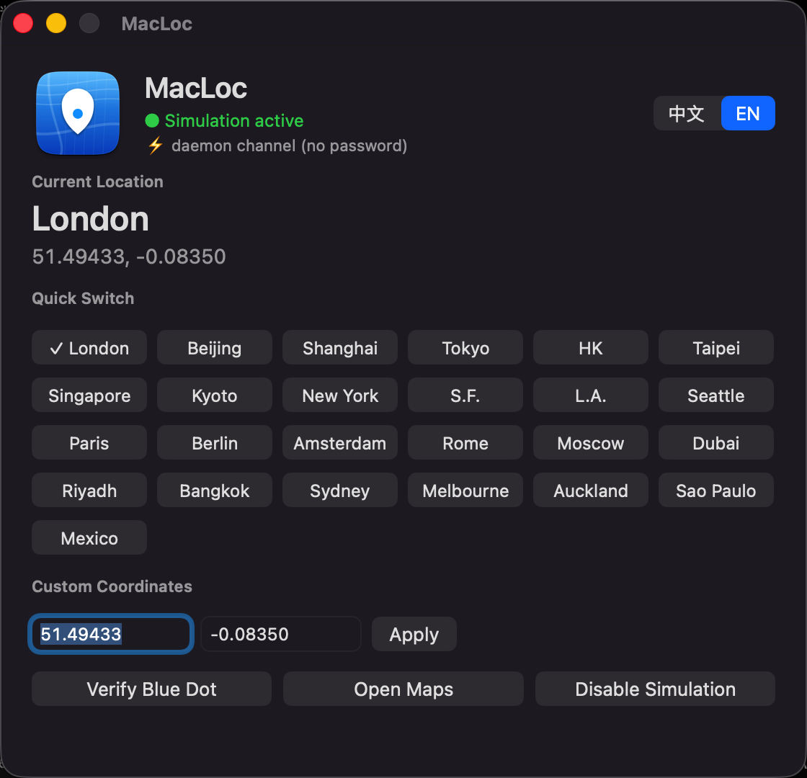

# macloc — macOS 全系统定位模拟

在 Apple Silicon Mac 上把**系统级**定位改成任意经纬度。

改的是 `locationd` 自己的模拟 provider，所以凡是拿到「定位服务」授权的程序 —— 系统地图、Safari、微信、打车 App —— 读到的都是你指定的坐标，而不是设备当前的位置。

**English | [README.en.md](README.en.md)** · [MIT License](LICENSE)

```
./install.sh 39.9042 116.4074    # 装（北京）
./install-daemon.sh              # 装免密码 daemon
./build-ui.sh                    # 编译菜单栏 App
open /Applications/MacLocBar.app # 点一个城市，3~6 秒生效，全程不输密码
```



---

## 目录

- [效果](#效果)
- [前置条件](#前置条件)
- [安装](#安装)
- [使用](#使用)
- [工作原理](#工作原理)
- [daemon 协议](#daemon-协议)
- [验证](#验证)
- [已知边界](#已知边界)
- [卸载](#卸载)
- [它会动系统](#它会动系统)
- [安全设计](#安全设计)
- [文件清单](#文件清单)
- [License](#license)

---

## 效果

| | 当前定位 | 修改后 |
|---|---|---|
| 系统地图「当前位置」蓝点 | 你的实际位置 | 你指定的坐标 |
| Safari / 微信 / 打车 App | 你的实际位置 | 你指定的坐标 |
| 坐标精度 | 真实 | 固定 `hAcc = 5 m` |
| 生效耗时 | — | ≈ 2 s（daemon 冷启 ≈ 5 s） |

改一次坐标，**所有** CoreLocation 客户端一起变 —— 不需要逐个 App 处理。

---

## 前置条件

### 按通道一览

| | **A 偏好通道** | **B daemon 通道** | **C XPC 通道** |
|---|---|---|---|
| 脚本 | `install.sh` / `set.sh` / `stop.sh` | `install-daemon.sh` / `loc.sh` | `xpc-push.sh` |
| 管理员密码 | 每次都弹 | 只装那一次 | 不要 |
| **要关 SIP 吗** | **不用** | **不用** | **要，且必须重启** |
| 图形桌面登录 | 必需 | 必需 | 不需要 |
| Xcode CLT | 不需要 | 需要 | 需要 |
| 要重启 locationd | 是 | 是 | 否 |
| 换坐标耗时 | ≈ 2 s | ≈ 2 s | 即时 |
| 有图形 UI | 无 | 有（MacLocBar.app） | 无 |

### 硬性要求

**1 · Apple Silicon（arm64）**

`install.sh` 第一件事就是检查 `uname -m`，不是 `arm64` 直接退出。
（`arm64e` 也认，它是 arm64 的变体。）

**2 · 一台登录着的图形桌面**

- 管理员授权框走 `osascript ... with administrator privileges`，需要 GUI 会话才能弹出来。
  **纯 SSH 跑不了 `install.sh`** —— 会失败或直接挂住。
- daemon 只接受**控制台登录用户**或 root 的连接（`getpeereid` 校验对端 uid），
  别的用户连上去会收到 `ERR PERMISSION`。

**3 · 管理员密码**

装的时候弹一次系统授权框，输一次即可。
不需要免密 sudo，也不用改 `sudoers` —— 脚本每次都走系统原生授权框。

**4 · Xcode Command Line Tools**

只有这几样需要编译：

| 脚本 | 为什么要编译 |
|---|---|
| `install-daemon.sh` | 编 `maclocd`（Swift） |
| `build-ui.sh` | 编 `MacLocBar.app`（Swift） |
| `build-icon.sh` | 编图标生成器 |
| `verify.sh` | 编 `finddot`（截屏找蓝点） |
| `xpc-push.sh` | 编注入 dylib（arm64e） |

```bash
xcode-select --install
```

只用通道 A 的 `install.sh` / `set.sh` / `stop.sh` **不需要**这一步。

**5 · 系统自带工具**（macOS 自带，不用装）

`/usr/libexec/PlistBuddy` · `/usr/bin/codesign` · `/bin/launchctl` · `/usr/bin/nc` · `/usr/sbin/screencapture`

**6 · 「定位服务」总开关**

`install.sh` 会帮你打开（写 `LocationServicesEnabled = true`）。
但**总开关关着的时候**，模拟坐标照样产出，所有客户端只会拿到 `kCLErrorDomain error 1`（LocationUnknown），蓝点不动。

**7 · 目标 App 自己的定位授权（TCC）**

要验证效果的那个 App，必须自己拿到「系统设置 → 隐私与安全性 → 定位服务」授权，否则读不到位置。
系统组件（Wi-Fi 栈、CountryTracker、Find My）不受这个限制。

### SIP 到底要不要关

**通道 A / B：不用关。** 两条通道都是改 `locationd` 自己的偏好，不注入任何东西、不加载任何第三方二进制。

**通道 C：必须关，而且必须重启。**

```bash
sudo csrutil disable --no-internal
# 重启
```

原因：通道 C 要把 dylib 注入 `/System/Library/CoreServices/CoreLocationAgent.app`。
那是 **arm64e 平台二进制**，SIP 打开时 dyld 直接拒绝注入。

### 可选依赖

| 功能 | 额外需要 |
|---|---|
| `verify.sh` | Apple 地图（系统自带）+ 给终端的「屏幕录制」权限 |
| `tools/uitest.sh` | 给终端的「辅助功能」权限 |
| `tools/loctest-app.sh grant` | `sqlite3` + 给终端的「完全磁盘访问」（要读写 `TCC.db`） |

### 一键自检

前置条件都跑一遍，输出 OK / WARN / FAIL：

```bash
./preflight.sh
```

```
[ OK ] 架构                   Apple Silicon (arm64) ✅
[ OK ] 图形会话               控制台用户 = <you> ✅（管理员授权框需要它）
[ OK ] 授权弹窗               osascript 可用（安装时弹一次系统授权框）✅
[ OK ] swiftc                 .../swiftc ✅（编译 daemon / UI）
[INFO] SIP                    disabled —— 通道 A/B 不需要关；通道 C 需要关
[ OK ] 定位服务总开关         已打开 ✅（客户端才有位置可读）
```

有 `FAIL` 会直接退出码 1；有 `WARN` 只提示，不拦人。

---

## 安装

```bash
git clone https://github.com/Rick-Song1999/Macloc.git
cd Macloc
```

### 通道 A · 偏好通道（最小可用）

```bash
./install.sh 39.9042 116.4074     # 纬度 经度（北京）
```

弹一次管理员授权框，装完即生效。
脚本做四件事：检查环境 → 打开「定位服务」总开关 → 写模拟坐标 → 重启 `locationd` 并回读校验。

### 通道 B · daemon + 图形 UI（推荐）

```bash
./install-daemon.sh    # 装 root daemon，之后改坐标不再要密码
./build-ui.sh          # 编译 MacLocBar.app 并装到 /Applications
open /Applications/MacLocBar.app
```

`build-ui.sh` 优先免密安装（`/Applications` 是 `775 root:admin`，你在 `admin` 组里就行）；
权限被改过才弹一次授权框。

### 通道 C · XPC 实时通道（可选）

```bash
sudo csrutil disable --no-internal && sudo reboot

./xpc-push.sh 22.3193 114.1694     # 实时切到香港，不重启 locationd
./xpc-push.sh --stop                # 停掉
```

---

## 使用

### 图形 UI（MacLocBar.app）

打开就是主窗口，26 个预设城市点一下就切：

```
┌──────────────────────────────────────────┐
│  [App 图标]  MacLoc                       │
│              ● 模拟定位生效中             │
│              ⚡ daemon 通道（免密码）     │
│                                          │
│  当前位置                                 │
│  伦敦 London                              │
│  51.49433, -0.08350                       │
│                                          │
│  快速切换                                 │
│  ✓伦敦 北京 上海 东京 香港 台北           │
│   新加坡 京都 纽约 旧金山 洛杉矶 西雅图   │
│   巴黎 柏林 阿姆 罗马 莫斯科 迪拜         │
│   利雅得 曼谷 悉尼 墨尔本 奥克兰 圣保罗   │
│   墨西哥                                  │
│                                          │
│  自定义坐标  [51.49433] [-0.08350] [应用] │
│  [验证蓝点位置] [打开地图] [关闭模拟定位]  │
│  ✓ 已切换位置  伦敦 London                │
└──────────────────────────────────────────┘
```

- 菜单栏右侧是**蓝色地图定位点**图标，点开是快捷菜单（预设位置 / 自定义坐标 / 验证 / 关闭 / 语言 / 退出）。
- 界面**中英双语**，主窗口右上角 `中文 │ EN` 一点就切，菜单栏 →「语言 ▸」也能切。
- 首次启动跟随系统语言，之后记住你的选择。
- App 是**「打开才跑」**，默认不装开机自启。想开机就有图标：
  ```bash
  ./install-login.sh            # 装自启（LaunchAgent com.macloc.bar）
  ./install-login.sh --remove   # 卸掉
  ```
- 关掉 App 之后系统里**一个 macloc 进程都不剩**（daemon 也会顺手收工）。

### 命令行

| 命令 | 作用 |
|---|---|
| `./loc.sh <lat> <lon>` | 改坐标，自动选通道：daemon 优先，否则回退授权框 |
| `./set.sh <lat> <lon>` | 改坐标，永远走授权框通道 |
| `./status.sh` | 看当前状态（daemon 通道 / 坐标 / 是否生效） |
| `./verify.sh` | 自动验证：开地图 → 截图 → 找蓝点 → 存特写 |
| `./stop.sh` | 关掉模拟定位，恢复原状 |
| `./preflight.sh` | 查前置条件 |

参数顺序是 **纬度 经度**。

```bash
./loc.sh 35.6762 139.6503     # 东京
./loc.sh 51.49433 -0.08350    # 伦敦
```

daemon 通道也可以直接用 `nc` 打：

```bash
printf 'SET 51.49433 -0.08350\n' | nc -U /var/run/macloc.sock
```

### 预设城市

伦敦 · 北京 · 上海 · 东京 · 香港 · 台北 · 新加坡 · 京都 · 纽约 · 旧金山 · 洛杉矶 · 西雅图 ·
巴黎 · 柏林 · 阿姆斯特丹 · 罗马 · 莫斯科 · 迪拜 · 利雅得 · 曼谷 · 悉尼 · 墨尔本 · 奥克兰 ·
圣保罗 · 墨西哥城

---

## 工作原理

### 通道 A · 偏好通道

`locationd` 内置一个 **`CLSimulatedLocationProvider`**，启动时从**它自己的偏好域**读四个键：

```
/var/db/locationd/Library/Preferences/ByHost/com.apple.locationd.<hostUUID>.plist
    AllowSimulatedLocations      = true
    SimulatedLocationLatitude    = <lat>
    SimulatedLocationLongitude   = <lon>
    SimulatedLocationAccuracy    = 5
```

命中后 `locationd` 打 `@ClxProvider, start, simulated`，然后**每秒产一条 `@ClxSimulated` fix**，
优先级高于所有真实 provider，广播给所有已注册的 CoreLocation 客户端。

同一份键也会写进 `/Library/Managed Preferences/com.apple.locationd.plist`（MCX）保持同步，
并在那里维护 `LocationServicesEnabled` 总开关。

> ⚠️ 用户域的 `~/Library/Preferences/com.apple.locationd.plist` 里同名键 **locationd 不读**。
> 必须写 `/var/db/locationd/Library/Preferences/ByHost/` 下面那份。

> ⚠️ **改完坐标必须重启 `locationd`**，否则 simulated provider 还在用缓存的旧值。
> 脚本每次都会 `killall cfprefsd` + `killall -u _locationd locationd`，然后回读校验。

### 通道 B · daemon 通道

在通道 A 之上加一个 root 守护进程，通过 unix socket 接收改坐标指令。

装的东西：

| 路径 | 作用 |
|---|---|
| `/Library/LaunchDaemons/com.macloc.agent.plist` | launchd 配置（**socket 激活，按需运行**） |
| `/usr/local/libexec/macloc/maclocd` | 守护进程本体 |
| `/var/run/macloc.sock` | unix socket（0666，launchd 建的） |
| `/var/db/macloc/state` | 权威状态（`root:wheel 0644`） |
| `/var/db/macloc/backup` | 原始偏好备份（`root:wheel 0700`） |
| `/var/log/maclocd.log` | daemon 日志 |

**按需运行**：plist 里 `RunAtLoad=false` + `KeepAlive=false`，另挂一个 `Sockets` 字典：

```xml
<key>Sockets</key>
<dict>
  <key>com.macloc.sock</key>
  <dict>
    <key>SockPathName</key>  <string>/var/run/macloc.sock</string>
    <key>SockPathMode</key>  <integer>438</integer>   <!-- 0666 -->
    <key>SockFamily</key>    <string>Unix</string>
  </dict>
</dict>
```

于是：

| 时刻 | 系统里有什么 |
|---|---|
| 平时（没开 App） | **一个 macloc 进程都没有**，只有 launchd 守着的 socket 文件 |
| 有客户端连上 | launchd 才拉起 `maclocd`（root） |
| 干完活 | 空闲 **20 秒**后 daemon 自己退出 |
| App 退出 | 发 `QUIT`，daemon 协作式退场（有命令在飞不退） |

### 通道 C · XPC 通道

`CoreLocation.framework` 私有类 `CLSimulationManager` → mach service `com.apple.locationd.simulation`。

该服务**校验客户端签名**，必须带 `com.apple.locationd.simulation` entitlement ——
全系统只有 `/System/Library/CoreServices/CoreLocationAgent.app` 拥有它。

所以做法是把 `spoof.dylib` 注入 `CoreLocationAgent`，以它的合法身份把坐标推进 `locationd`。
`locationd` 会打 `Setting simulation to 1 for all location providers`。

三个硬性约束：

- dylib **必须编成 `arm64e`**。平台二进制是 arm64e，注入 arm64 会被 dyld 直接拒。
- dylib 必须**原子替换**（`cp x.new && mv`）。原地 `cp` 覆盖仍被映射的 inode 会让 AMFI 报
  `SIGKILL (Code Signature Invalid)`，`CoreLocationAgent` 崩溃循环。
- 换坐标必须**先 `stopLocationSimulation` + `clearSimulatedLocations`，再 `append` + `start`**。
  否则 `fSimulationRunning` 一直是 1，不会触发 `LocationProvider is notifying clients`，客户端收不到新位置。

### 为什么不去改网络位置请求

macOS 的网络位置估计走 `locationd` 内置的 HTTPS 端点（`gsp10-ssl.apple.com/hcy/pbcwloc`），
有证书信任和设备维度绑定，而且结果只是融合算法众多输入之一 —— 改它既不生效也会被稀释。
Wi-Fi 没关联时那条路一开始就不存在。走系统自带的模拟 provider 才是确定性的。

---

## daemon 协议

unix socket `/var/run/macloc.sock`，一行一条命令，`\n` 结尾：

| 命令 | 返回 |
|---|---|
| `PING` | `PONG` |
| `SET <lat> <lon>` | `OK <lat> <lon>` / `ERR <CODE> [detail]` |
| `OFF` | `OK off` / `ERR <CODE> [detail]` |
| `SYNC <lat> <lon> <on>` | `OK sync`（只更新状态文件，不动偏好） |
| `STATUS` | `ON <lat> <lon>` / `OFF` |
| `QUIT` | `OK quit`（让 daemon 收工退出） |

错误码：

| CODE | 含义 |
|---|---|
| `INVALID_COORD` | 坐标越界（纬度 -90..90，经度 -180..180） |
| `NO_PREF_FILE` | 找不到可用的 locationd 偏好文件 |
| `UNKNOWN_CMD` | 未知命令 |
| `PERMISSION` | 不是控制台用户也不是 root |
| `WRITE_FAILED` | 写偏好 / 状态失败 |
| `BAD_ARGS` | 参数个数不对 |
| `RESTART_FAILED` | `locationd` 重启失败 |
| `VERIFY_FAILED` | 回读校验不一致 |

```bash
printf 'SET 999 999\n' | nc -U /var/run/macloc.sock
# ERR INVALID_COORD latitude must be -90..90, longitude -180..180
```

---

## 验证

**最直观**：打开系统地图，蓝点应该落在目标城市。

```bash
open -a Maps
```

**自动验证**（开图 → 截图 → 找蓝点 → 存特写）：

```bash
./verify.sh
open ~/.macloc/verify.png
```

原理：Apple 地图「当前位置」蓝点实测颜色是 `RGB(0,145,255)`，`tools/finddot` 在截屏里按这个颜色做聚类定位。
输出 `~/.macloc/verify.png`（蓝点特写）和终端上的像素坐标。

**看日志**：

```bash
/usr/bin/log show --predicate 'process == "locationd"' --last 2m --style compact | grep -i simul
```

| 日志 | 含义 |
|---|---|
| `Using simulated location from defaults` | 偏好通道生效 |
| `@ClxProvider, start, simulated` | 模拟 provider 已启动 |
| `@ClxSimulated, Fix, ...` | 正在产出模拟位置（每秒一条） |
| `@ClxClient, Fix, ...` | 位置已投递给客户端 |
| `Sending location to client ... com.apple.Maps` | 蓝点已更新 |
| `Setting simulation to 1 for all location providers` | XPC 通道生效 |
| `location disabled system-wide` | **「定位服务」总开关关着** |
| `unentitled client attempting to simulate location` | entitlement 校验失败 |

日志里的坐标是 `<private>` / `<redacted>`，**只能靠 Maps 蓝点截图验证**。

---

## 已知边界

1. **目标 App 自己得有「定位服务」授权（TCC）**。
   没授权 → `kCLErrorDomain error 1`。系统组件不受这个限制。

2. **IP 网络位置是另一条链路，骗不到。**
   日志里 `got response from GeoServices about IP-based country` —— 那条按 **IP + Wi-Fi 指纹**判国家，
   仍然是真实网络所在地。靠 IP 反查地理位置的服务（很多风控）看不出来。

3. **时区 / 区域设置不是模拟写出来的。**
   `TimeZone.bundle` 也在消费 locationd 的位置，长期开着模拟有可能让系统自动跟着漂。

4. **改坐标必须重启 `locationd`（通道 A/B）。**
   坐标本身是持久的（写在磁盘上），但 `locationd` 重启前不会重新读。

5. **Intel Mac 不支持**（见[前置条件](#硬性要求)）。

---

## 卸载

```bash
./stop.sh                                  # 关掉模拟，恢复原始偏好
./install-login.sh --remove                # 卸掉开机自启（如果装了）

sudo rm -f /Library/LaunchDaemons/com.macloc.agent.plist
sudo launchctl bootout system/com.macloc.agent   # 卸 daemon
sudo rm -rf /usr/local/libexec/macloc /var/db/macloc /var/log/maclocd.log

rm -rf ~/.macloc                           # 用户态日志 / 状态副本
rm -rf /Applications/MacLocBar.app        # 图形 UI
```

「定位服务」总开关会保持打开（方便以后再用）。要彻底恢复，去
「系统设置 → 隐私与安全性 → 定位服务」手动关掉。

---

## 它会动系统

| 位置 | 动作 |
|---|---|
| `/var/db/locationd/Library/Preferences/ByHost/com.apple.locationd.*.plist` | 写入 / 恢复模拟坐标与开关 |
| `/Library/Managed Preferences/com.apple.locationd.plist` | 同上（MCX 兜底） |
| `locationd` / `cfprefsd` | 重启 |
| `/Library/LaunchDaemons/com.macloc.agent.plist` | 装一个 system 域 launchd 任务（按需运行，不常驻） |
| `/usr/local/libexec/macloc/maclocd` | daemon 本体（root） |
| `/var/db/macloc/` | 状态 + 原始偏好备份 |
| `/var/log/maclocd.log` | daemon 日志 |
| `/Applications/MacLocBar.app` | 图形 UI |
| `~/Library/LaunchAgents/com.macloc.bar.plist` | 开机自启 —— **默认不装** |

全部可逆，`./stop.sh` + 上面的卸载步骤能还原。

---

## 安全设计

- **提权走系统原生授权框**（`osascript ... with administrator privileges`），
  不改 `sudoers`、不需要免密 sudo、也不把密码存到磁盘。
- **坐标不会被当成命令执行。** 参数先规范化成 `%.6f %.6f` 的纯数字串（范围 -90..90 / -180..180），
  不合法直接拒绝；root 脚本里坐标只以 `LAT="51.494330"` 形式出现，不参与任何命令拼接。
- **root 写盘只碰常量路径**，且跳过符号链接、只接受 `root` / `_locationd` 拥有的常规文件。
- **daemon 不写用户家目录。** 权威状态在 `/var/db/macloc/state`（root 拥有），
  用户域的 `~/.macloc/state` 只是只读回退副本。
- **socket 权限 0666，但 daemon 校验对端 uid**（`getpeereid`）：只有控制台登录用户或 root 能用。
- **每一步都查返回值**，失败打 `MACLOC_STEP_FAIL: <哪一步>`，绝不谎报成功；
  写完**回读校验**（容差 1e-4）并确认 `locationd` 真的起来了。
- **关掉时从备份恢复**原始 `LocationServicesEnabled`，不强行设 true。

请只在自己有权限的机器上使用。修改定位会让所有基于 CoreLocation 的程序（打卡、签到、风控、轨迹记录）
读到另一个坐标 —— 在别人不知情的情况下使用既不道德，也可能违反服务条款。

---

## 文件清单

```
macloc/
├── preflight.sh         前置条件自检（架构 / 图形会话 / 工具链 / SIP / 定位开关）
├── install.sh           通道 A 一键安装（打开总开关 + 写坐标 + 重启 locationd）
├── set.sh               改坐标（重启 locationd，弹授权框）
├── loc.sh               改坐标（自动选通道：daemon 优先，否则回退授权框）
├── stop.sh              关闭模拟并恢复原状（自动选通道）
├── status.sh            状态（daemon 通道 / 坐标 / 是否生效）
├── verify.sh            自动验证（开图 + 找蓝点 + 存特写）
├── xpc-push.sh          通道 C：XPC 实时切换（需 SIP 关闭）
├── install-daemon.sh    装 root daemon（免密码通道，socket 激活按需运行）
├── install-login.sh     开机自启（可选，默认不装）
├── build-ui.sh          构建 MacLocBar.app（菜单栏 UI + 主窗口，装到 /Applications）
├── build-icon.sh        生成 App 图标 .icns（dark / light / neon）
├── lib/macloc.sh        公共库（提权 / 坐标规范化 / 状态检测 / 提示输出）
├── lib/apply-coords.sh  以 root 写 locationd 偏好的核心逻辑（常量路径，可单测）
├── daemon/maclocd.swift root daemon 源码（unix socket 服务 + 按需运行 + 空闲自杀 + QUIT）
├── daemon/LaunchShim.h  C shim：取 launchd 传入的 socket fd（运行时自适应两种指针布局）
├── spoof.dylib.m        通道 C 的注入 dylib 源码（arm64e）
├── ui/MacLocBar.swift   UI 源码（NSStatusItem + 主窗口 + 中英 i18n）
├── ui/AppIcon.icns      App 图标（1024×1024 起，10 个尺寸）
├── tools/uitest.sh      端到端 UI 测试（AXPress 触发按钮 + 校验结果）
├── tools/loctest-app.sh 造一个第三方 .app 探针，验证模拟是否全局
├── tools/loctest.swift  探针源码（CoreLocation 视角）
├── tools/finddot.m      截图中定位「当前位置」蓝点
├── tools/makeicon.swift App 图标生成器（纯 CoreGraphics）
├── tools/click.m        模拟点击（自动化测试用）
├── tools/winid.m        打印 App 的 CGWindowNumber
├── tools/menubarpos.m   在截屏菜单栏里定位 MacLoc 图标
├── docs/screenshot-panel.png  README 用的主窗口截图
└── README.md
```

运行时文件：

| 路径 | 内容 |
|---|---|
| `~/.macloc/` | 用户态日志、坐标文件、状态回退副本、验证截图 |
| `/var/db/macloc/state` | 权威状态（root 拥有） |
| `/var/db/macloc/backup` | 原始偏好备份（root 拥有，`0700`） |
| `/var/log/maclocd.log` | daemon 日志 |

---

## 贡献者

| | |
|---|---|
| [Rick-Song1999](https://github.com/Rick-Song1999) | 项目发起、维护、打包发布 |
| [opencode-agent](https://github.com/opencode-agent) | 代码实现（opencode 编码助手） |
| [MiniMax-AI-Dev](https://github.com/MiniMax-AI-Dev) | 代码实现（MiniMax 模型） |

本仓库大部分代码由 AI 编码助手（opencode + MiniMax）编写。提交历史里的 `Co-authored-by` trailer
就是 GitHub 贡献者归属用的，对应上面两个账号。

---

## License

MIT —— 见 [LICENSE](LICENSE)。
